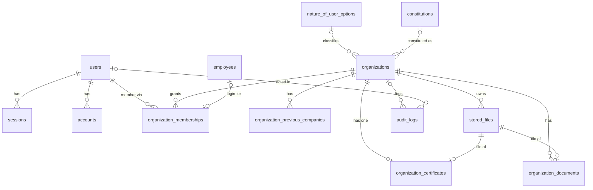
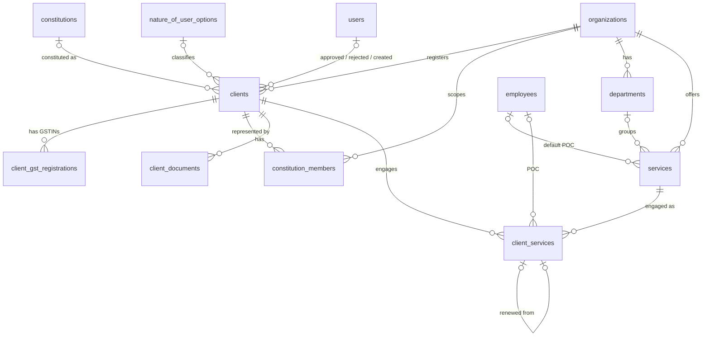
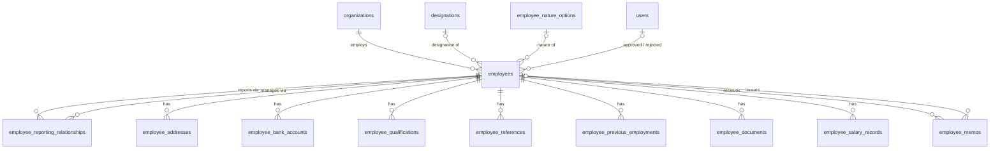
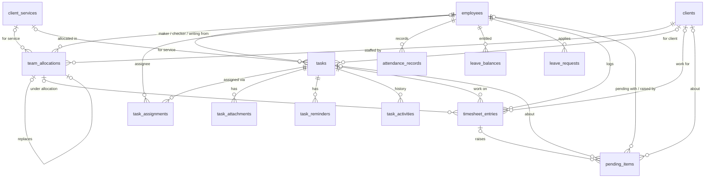
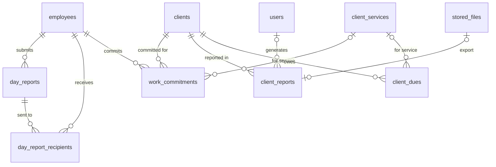

# SS Dimri — Database Relationships

All relationships below are real foreign keys in the deployed database (see the FK column of [database-schema-reference.md](database-schema-reference.md) for exact on-delete actions). Diagrams are split by domain for readability; they show keys and relationships, not every attribute.

## 1. One-to-one

| Parent | Child | Enforced by |
|---|---|---|
| `organizations` | `organization_certificates` | `organization_certificates.organization_id` UNIQUE — **one certificate per organization** |
| `employees` | `organization_memberships` (login for that employee) | `organization_memberships.employee_id` UNIQUE (optional) |
| `client_services` | `client_services` (renewal) | `renewed_from_id` UNIQUE — each engagement renewed at most once |
| `team_allocations` | `team_allocations` (allocation change) | `replaces_allocation_id` UNIQUE — linear change history |
| `stored_files` | each single-slot owner (organization/client/employee/member profile pictures; MSME/ESI/PF certificates; Aadhaar/PAN documents; bank book; qualification & experience certificates; memo file; organization certificate & documents; client documents & POs; employee documents; task attachments; attendance photos; client report export) | UNIQUE file FK column on the owner |

## 2. One-to-many

| One | Many | FK column |
|---|---|---|
| `users` | `sessions`, `accounts` | `user_id` |
| `users` | `organization_memberships` | `user_id` |
| `users` | approvals/rejections on `clients`, `employees`; `leave_requests` decisions | `approved_by_id`, `rejected_by_id`, `decided_by_id` |
| `users` | `stored_files` (uploader), `audit_logs` (actor), `task_activities` (actor), created-by columns | various |
| `nature_of_user_options` | `organizations`, `clients`, `services` | `nature_of_user_id` |
| `constitutions` | `organizations`, `clients` | `constitution_id` |
| `organizations` | every tenant-scoped table (`clients`, `employees`, `services`, `departments`, `designations`, `tasks`, `attendance_records`, `timesheet_entries`, `pending_items`, …) | `organization_id` |
| `organizations` | `organization_documents`, `organization_previous_companies`, `constitution_members` (org’s own representatives when `client_id` is NULL) | `organization_id` |
| `clients` | `client_gst_registrations` (**multiple GSTINs**) | `client_id` |
| `clients` | `constitution_members`, `client_documents` | `client_id` |
| `clients` | `client_services`, `team_allocations` (**multiple allocations**), `tasks`, `timesheet_entries`, `pending_items`, `work_commitments`, `client_reports`, `client_dues` | `client_id` |
| `departments` | `services` | `department_id` |
| `services` | `client_services` | `service_id` |
| `client_services` | `team_allocations`, `tasks`, `timesheet_entries`, `work_commitments`, `client_dues` | `client_service_id` (optional) |
| `designations` | `employees` | `designation_id` |
| `employee_nature_options` | `employees` | `nature_id` |
| `employees` | `employee_addresses`, `employee_bank_accounts`, `employee_qualifications`, `employee_references`, `employee_previous_employments`, `employee_documents`, `employee_salary_records`, `employee_memos` | `employee_id` |
| `employees` | `team_allocations` (**multiple allocations per employee**), `attendance_records`, `leave_balances`, `leave_requests`, `timesheet_entries`, `day_reports`, `work_commitments` | `employee_id` / `reporting_employee_id` |
| `employees` | `tasks` as **maker**, **checker**, writing-from | `maker_employee_id`, `checker_employee_id`, `writing_from_employee_id` |
| `employees` | `pending_items` (pending with / raised by) | `pending_with_employee_id`, `raised_by_employee_id` |
| `employees` | `employee_memos` (issued by), `services` / `client_services` (point of contact), `task_reminders` (recipient) | various |
| `tasks` | `task_attachments`, `task_reminders`, `task_activities` | `task_id` |
| `tasks` | `timesheet_entries`, `pending_items` (optional link) | `task_id` |
| `team_allocations` | `timesheet_entries` (connection with timesheet) | `team_allocation_id` |
| `timesheet_entries` | `pending_items` | `timesheet_entry_id` |
| `day_reports` | `day_report_recipients` | `day_report_id` |

## 3. Many-to-many

| Relationship | Junction table | Uniqueness |
|---|---|---|
| Users ↔ Organizations | `organization_memberships` (+ role, status) | (organization_id, user_id) |
| Clients ↔ Services | `client_services` (+ fee, timeline, POC, nature, retainer dates) | none — a client may engage the same service again (e.g. each year) |
| Employee ↔ Employee (“Whom to Report”, multi-select) | `employee_reporting_relationships` (+ primary flag, dates) | (employee_id, manager_id); CHECK no self-reporting |
| Clients ↔ Employees (team allocation) | `team_allocations` (+ level, dates, %, status, change chain) | none — history is kept |
| Tasks ↔ Employees (assignees) | `task_assignments` (+ assigned by/at, removed at) | (task_id, employee_id) |
| Day reports ↔ Employees (managers) | `day_report_recipients` (+ sent/read/acknowledged) | (day_report_id, recipient_employee_id) |
| Clients ↔ Employees (committed work) | `work_commitments` (+ period, description, status) | none |

## 4. Self-referential relations (named in Prisma)

| Relation name | Table | Meaning |
|---|---|---|
| `ReportingEmployee` / `ReportingManager` | `employee_reporting_relationships` → `employees` (twice) | employee reports to manager |
| `MemoEmployee` / `MemoIssuedBy` | `employee_memos` → `employees` (twice) | memo subject vs issuer |
| `TaskMaker` / `TaskChecker` / `TaskWritingFrom` | `tasks` → `employees` (three times) | maker, checker, writing-from team member |
| `PendingWithEmployee` / `PendingRaisedBy` | `pending_items` → `employees` (twice) | who it is pending with vs who raised it |
| `ClientServiceRenewal` | `client_services` → `client_services` | renewal chain |
| `AllocationChange` | `team_allocations` → `team_allocations` | allocation change history |

## 5. ER diagrams

### 5.1 Organization, authentication, files

### 5.2 Clients, constitution, services

### 5.3 Employees

### 5.4 Allocation, tasks, attendance, timesheets, pending work

### 5.5 Reports and dues

