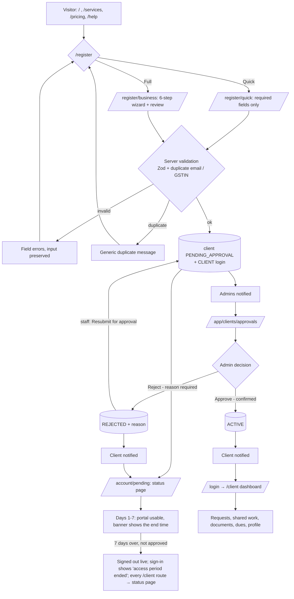
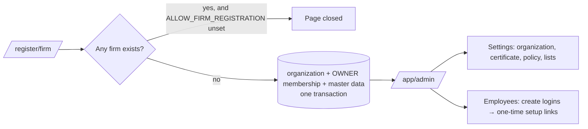
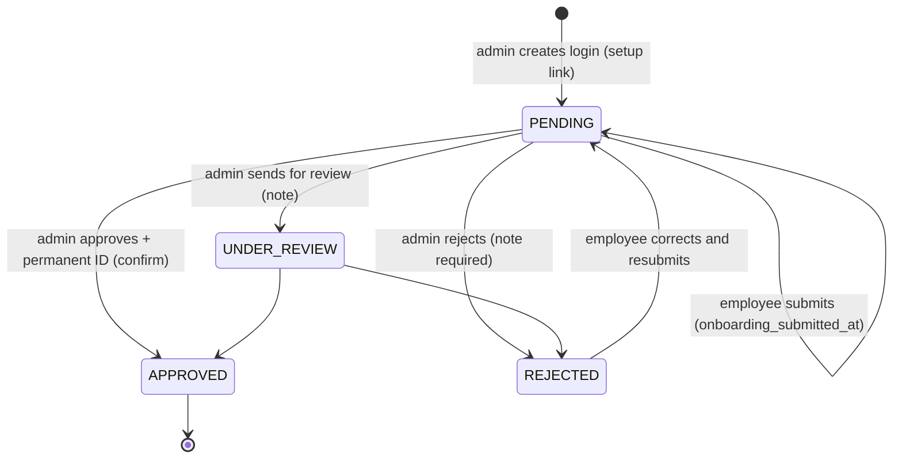
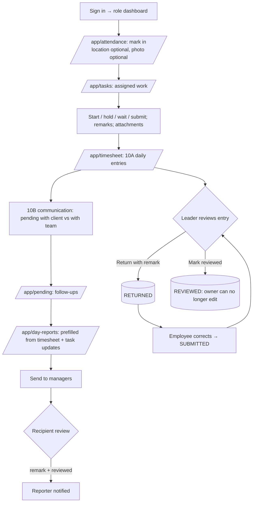
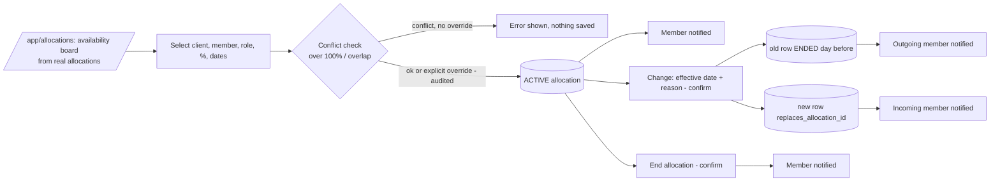
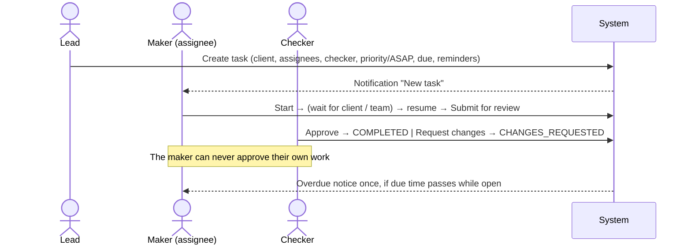
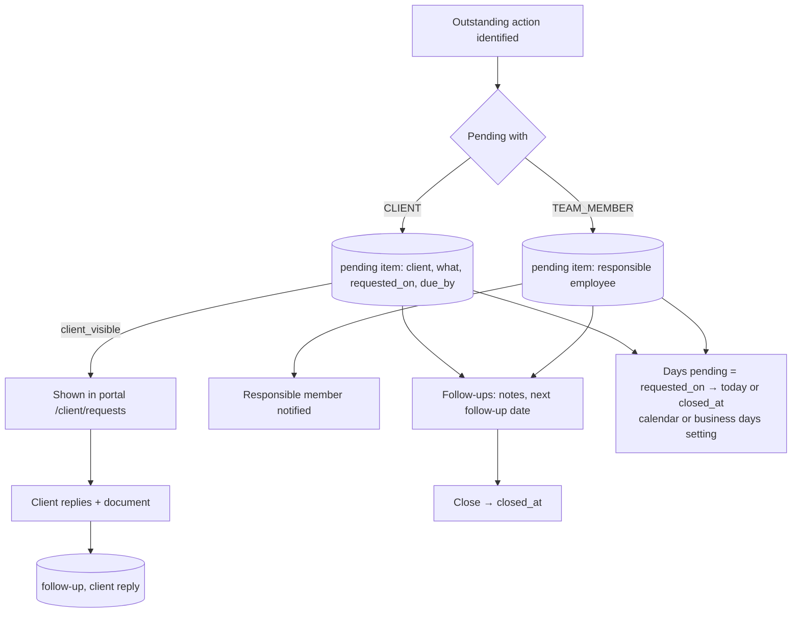
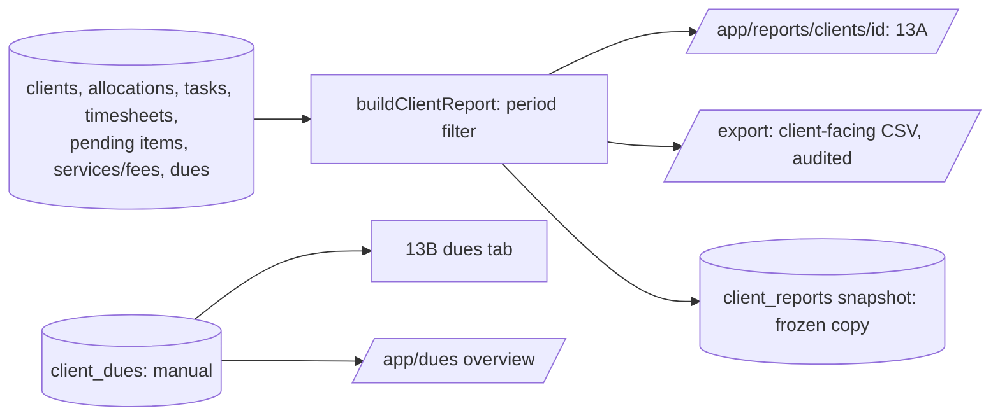

# User Journeys

End-to-end journeys as implemented, with success, failure, rejection and recovery paths. Each step names the route (see [page-inventory.md](page-inventory.md)), the server-side check, and the end-to-end test that exercises it (`tests/e2e/workflow.spec.ts`, "E2E: …"). A journey step without a test reference is implemented but not covered by an automated end-to-end test.

Status per journey uses the five classes from the addendum: **Implemented and tested**, **Implemented but not fully tested**, **Partially implemented**, **Blocked**, **Awaiting business confirmation**.

---

## A. Public visitor → registered business → client portal

**Status: Implemented and tested** (rejected-applicant self-correction: **Awaiting business confirmation**).

| Step | Route | Server control | Test |
|---|---|---|---|
| Quick registration | `/register/quick` | Zod; rate limit; email uniqueness; GSTIN duplicate check; one transaction | E2E: "a business registers itself (quick)…" |
| Full wizard | `/register/business` | Same, plus constitution-specific representatives, GSTIN format/duplicates | E2E: "full business registration wizard…" |
| Pending business: 7-day access, then locked | `/client/*` | `clientAccess` in `getContext`; `requireClientContext`; `AccessWatcher` | E2E: "a business registers itself (quick)…", "day 8: a business still awaiting approval…" |
| Clients never reach staff pages | `/app/*` | `requireContext` | E2E: quick registration test |
| Approval | `/app/clients/[id]` | `clients.approve`; state machine; optimistic status check; audit; notification | E2E: "admin approval queue…" |
| Rejection & resubmission | `/app/clients/[id]` | Reason required; record kept; staff `clients.edit` may resubmit | Unit: client workflow; not E2E |
| Remaining details after approval | Staff edit on `/app/clients/[id]` | `clients.edit` | Not E2E |

**Recovery:** a rejected applicant sees the reason and the office contact on `/account/pending`. Self-service correction by the applicant is **not** implemented; the firm has not confirmed whether applicants may edit and resubmit themselves (see [known-issues-and-decisions.md](known-issues-and-decisions.md) K-3).

## B. Firm owner registration

**Status: Implemented and tested.**

No password is ever shown to or set by another user: staff and invited client users receive single-use, hash-stored setup links (72 h). Test: E2E "owner registers the firm…", "owner creates staff logins…".

## C. Staff onboarding

**Status: Implemented and tested** (deactivation side effects: **Implemented but not fully tested**).

- For 7 days from login creation a pending member has their role's full access (banner with the end time). After that, until APPROVED, every capability-protected page redirects to `/app/onboarding`, actions are refused, and an open page signs out at the deadline. Rejection locks at once.
- The approver (`employees.manage`, Owner/Admin) also sets role and access status on the Access tab. **Nobody can change their own role or status**; the owner's role cannot be changed.
- Deactivating a login (status DISABLED) deletes its sessions immediately. Assigned tasks and allocations stay on the person's name until a lead reassigns them (K-7).
- Tests: E2E "employee sets a password via the link…", "admin approves onboarding…"; disabled-login behaviour is tested for client logins (E2E "a client cannot open another client's request; a disabled login loses access").

## D. Daily staff work

**Status: Implemented and tested.**

- Work submitted ≠ reviewed: timesheet entries carry SUBMITTED / RETURNED / REVIEWED; the client report shows *recorded* and *reviewed* hours separately.
- Tests: E2E "team member: attendance…, timesheet, pending item and day report"; "senior returns a timesheet entry…".

## E. Client and team allocation

**Status: Implemented and tested.**

History is the chain of `replaces_allocation_id` rows; earlier timesheet entries keep their original employee, so reassignment never re-attributes past work. Test: E2E "allocation conflicts are not saved silently".

## F. Task with maker–checker review

**Status: Implemented and tested.** States and roles in [workflow-state-machines.md](workflow-state-machines.md#3-task).

**Completed means:** status COMPLETED, reached only through a checker's approval (or a reviewer when no checker is named). Submitted (PENDING_REVIEW), changes requested, waiting (AWAITING_CLIENT / AWAITING_TEAM_MEMBER), on hold and reopened (COMPLETED → IN_PROGRESS by a lead) are distinct states. Test: E2E "task: maker/checker cycle…".

## G. Pending tracker and client communication

**Status: Implemented and tested.**

The original `requested_on` is never overwritten by reminders or follow-ups. Tests: E2E "staff request appears in the client portal…", unit tests for `daysPending`.

## H. Reporting and dues

**Status: Implemented and tested** (fee schedules, invoices, payments: **Awaiting business confirmation**).

- Current vs historical: the live report reads current records; a **snapshot** freezes it for the period. Agreed fees shown are the current values (labelled as agreed, not billed).
- A due is only *recorded*; nothing implies payment unless a user marks it SETTLED (with a follow-up note).
- Tests: E2E "client report shows team-wise hours…" (including CSV contents) and "staff without report rights cannot open the client report or its export".
