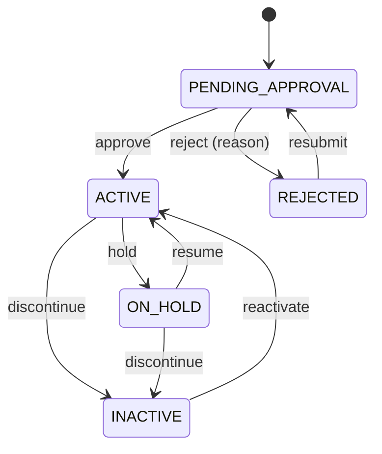
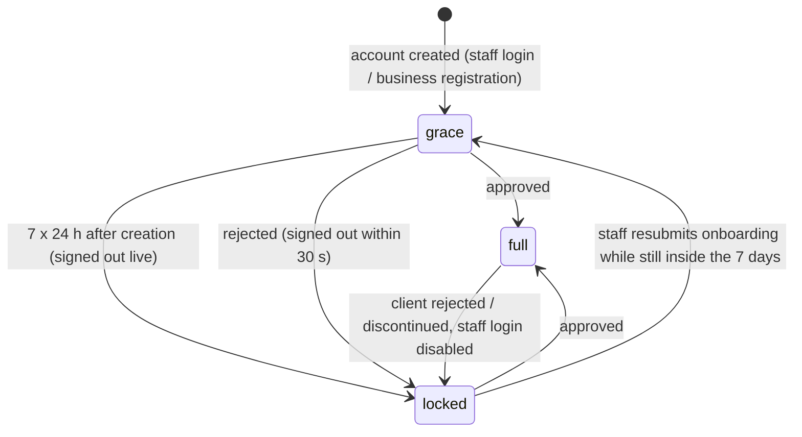
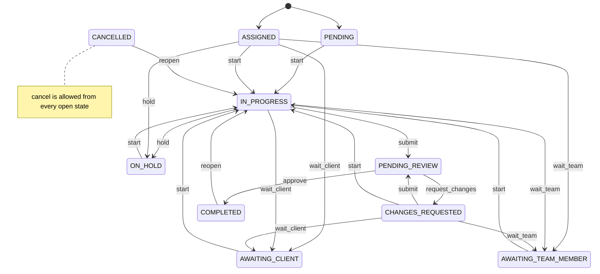
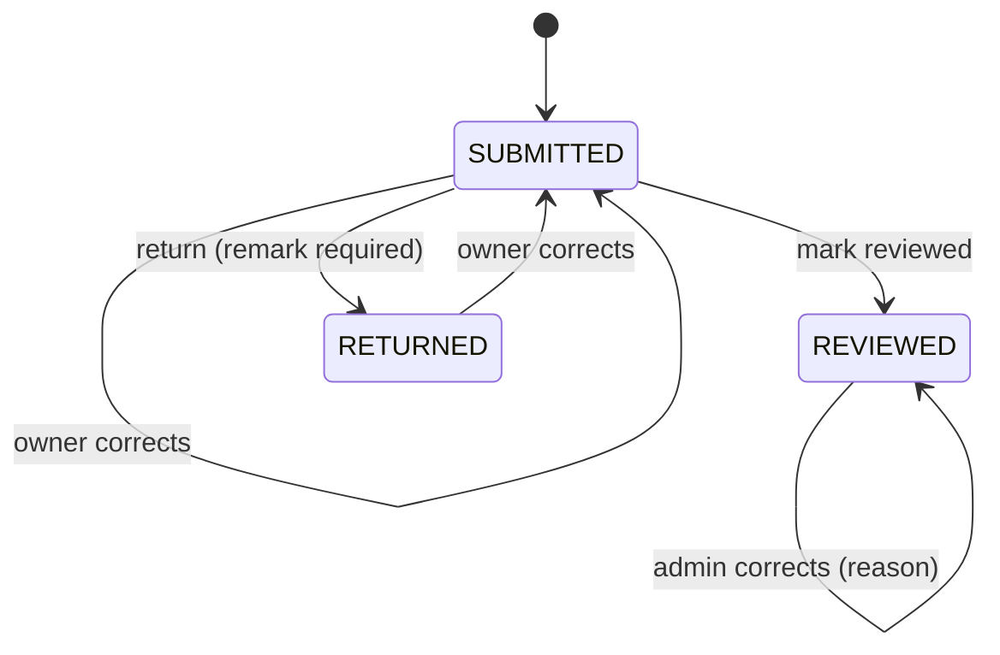
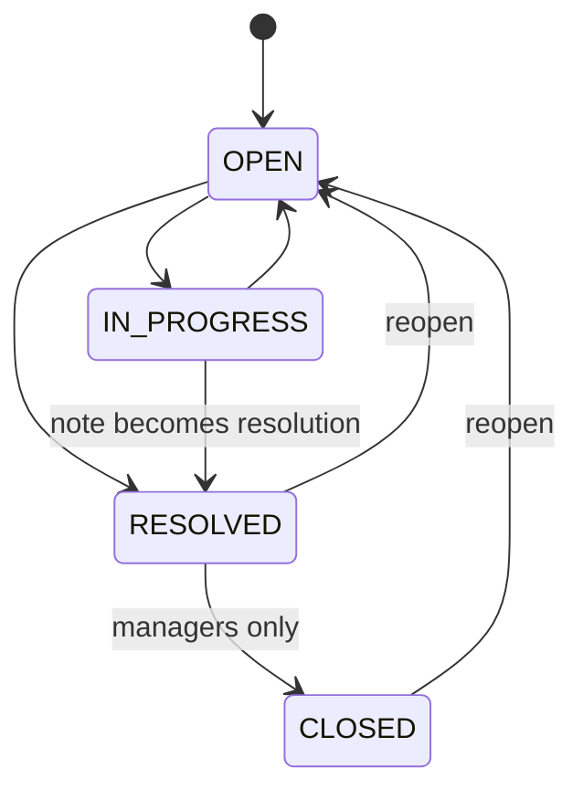

# Workflow State Machines

Every status below is a PostgreSQL enum in `prisma/schema.prisma`; every transition is decided on the server. Client-supplied status values are validated against these rules, never trusted. Pure rule modules are unit-tested (`tests/domain.test.ts`, `tests/rules.test.ts`).

Columns: **Who** = capability/role allowed (see [role-permission-matrix.md](role-permission-matrix.md)) · **Needs** = required fields/preconditions · **Notifies** · **Audit** = `audit_logs.action` · **On failure** = what the user sees; nothing is written.

Concurrency: transitions marked ⚡ use a conditional update (`WHERE status = <expected>`); if another user changed the record first, the action fails with "changed by someone else — refresh and try again".

## 1. Client (business) registration — `ClientStatus`

Source: `src/lib/domain/client-workflow.ts`, `src/lib/services/clients.ts`. Initial: `PENDING_APPROVAL` (public or staff quick registration; `DRAFT` reserved).

| Transition | Who | Needs | Notifies | Audit | Reversible by |
|---|---|---|---|---|---|
| approve ⚡ (confirm) | `clients.approve` (Owner, Admin) | — | client logins | `client.approve` | discontinue |
| reject ⚡ (confirm) | `clients.approve` | reason | client logins | `client.reject` | resubmit (staff) |
| hold / resume / discontinue / reactivate ⚡ | `clients.approve` | note optional | — | `client.<action>` | the opposite action |
| resubmit ⚡ | `clients.edit` (Owner, Admin, Manager) | — | Owner/Admin | `client.resubmit` | — |

Portal access exists only in ACTIVE and ON_HOLD.

## 2. Accounts and staff onboarding

### Login membership — `MembershipStatus`: `INVITED`, `ACTIVE`, `DISABLED`

| Transition | Who | Effect | Audit |
|---|---|---|---|
| ACTIVE → DISABLED (confirm) | `employees.manage` (staff) / `clients.approve` (client logins); never yourself; never the owner | Sessions deleted immediately; sign-in leads to `/account/inactive` | `employee.access_updated` / `client.portal_user_disabled`, `client.portal_user_active` |
| DISABLED → ACTIVE | same | Access restored | same |

### Onboarding — `EmployeeApprovalStatus`

Initial `PENDING`. See the diagram in [user-journeys.md §C](user-journeys.md#c-staff-onboarding).

| Transition | Who | Needs | Notifies | Audit |
|---|---|---|---|---|
| PENDING (invited) → UNDER_REVIEW | the staff member, by submitting details (required: mobile, PAN, Aadhaar, current address) | — | Owner/Admin (in app) | `employee.onboarding_submitted` |
| UNDER_REVIEW / ON_HOLD → APPROVED (confirm) ⚡ | `employees.manage`, not yourself | unique permanent employee ID; details submitted | staff member (email + app) | `employee.approve` |
| UNDER_REVIEW → ON_HOLD (confirm) ⚡ | `employees.manage` | optional note | staff member (email + app) | `employee.hold` |
| UNDER_REVIEW / ON_HOLD → REJECTED (confirm) ⚡ | `employees.manage` | reason | staff member (email + app) | `employee.reject` |
| REJECTED → UNDER_REVIEW | the staff member, by correcting and resubmitting | required details | Owner/Admin | `employee.onboarding_submitted` |

Before any of this, an invited login has `must_change_password = true`: only `/account/set-password` works until the emailed temporary password (valid 7 days, `temp_password_expires_at`) is replaced. Staff have **no grace period** (owner decision, 27 Oct 2026).

Approved is final for onboarding; later changes go through employment status (PROBATION / ACTIVE / EXITED) and membership status.

### Password links

Setup (72 h) and reset (2 h) links: single use, SHA-256 hash stored, raw token never stored or logged. Issued only by administrators (staff) or `clients.approve` (client logins), with confirmation.

### Access state while awaiting approval (computed on every request)

Source: `src/lib/domain/approval-access.ts`; enforced in `src/lib/session.ts` (pages, actions), `/api/files/[id]`, the report export and `/api/session/status`; mirrored live in the browser by `src/components/access-watcher.tsx`.

| State | Staff | Client login |
|---|---|---|
| full | Role's capabilities | Portal |
| grace | Role's capabilities + banner with end time | Portal + banner |
| locked | Onboarding page, profile (password) only | Registration status page only |

Owners and administrators are always *full*. Grace length: `organizations.approval_grace_days` (default 7).

## 3. Task — `TaskStatus`

Source: `src/lib/domain/task-workflow.ts`. Initial `PENDING` (no assignee) or `ASSIGNED`.

| Action | Who | Rule |
|---|---|---|
| start, hold, wait_client, wait_team, submit | assignee, maker, or `tasks.review` | — |
| approve, request_changes | named checker (or Owner/Admin); if no checker, `tasks.review` | **maker can never approve own work** |
| cancel (confirm) | `tasks.cancel` (Owner, Admin, Manager) | history kept; no delete for anyone |
| reopen | `tasks.review` | — |

Maker/checker sub-statuses (`MakerStatus`, `CheckerStatus`) follow these actions. "Overdue" is derived (`due_at` passed and status open), never stored; a one-time overdue notice is claimed via `tasks.overdue_notified_at`. Every transition writes a `task_activities` row and notifies the affected parties.

### Client review of shared work — `ClientObservationStatus` (on the task)

`NOT_SHARED` → `PENDING_CLIENT_REVIEW` (lead shares and requests review) → `ACCEPTED` or `OBSERVATIONS_RAISED` (client, from the portal; note required for observations, which also creates a client observation, §8).

## 4. Attendance

`AttendanceStatus`: PRESENT, ABSENT, LEAVE, HALF_DAY (one record per employee per day).

| Event | Who | Rule | Audit |
|---|---|---|---|
| Mark in | the employee | once per day ⚡ (conditional write + unique key); late flag from policy grace time, late reason requested; location and photo optional | — (the record itself stores who/when) |
| Mark out | the employee | after mark in, once ⚡ | — |
| Correction / record for another | `attendance.correct` (Owner, Admin) | reason required; original and new values kept in `attendance_corrections` | `attendance.corrected` |
| Leave request → APPROVED / REJECTED | `leave.decide`; reportees only for Manager/Senior; never own ⚡ | — | `leave.approved` / `leave.rejected` |

Half-day and overtime figures are indicative and policy-driven (two policy versions unconfirmed — [business-rules.md](business-rules.md)). Missing location is recorded as missing, not rejected.

## 5. Timesheet entry — `TimesheetStatus`

Initial `SUBMITTED` (entries are submitted as they are saved; `DRAFT` reserved).

| Transition | Who | Needs | Notifies | Audit |
|---|---|---|---|---|
| review / return ⚡ | `timesheet.review`, never own entry | remark for return | employee | `timesheet.reviewed` / `timesheet.returned` |
| correct (owner) | owner while not REVIEWED | changed fields | — | `timesheet.corrected` + field diff |
| correct (admin) | `org.manage`, any status | reason | — | `timesheet.corrected` + reason + diff |
| delete | owner while not REVIEWED (confirm) | — | — | — |

## 6. Pending item (12A / 12B) — `PendingStatus`

OPEN, IN_PROGRESS, AWAITING_RESPONSE, CLOSED. `pending_with` = CLIENT or TEAM_MEMBER (never both). Owner of the item or `pending.view_all` may update; closing sets `closed_at`; reopening clears it. Every update is a `follow_ups` row; client replies arrive as client-visible follow-ups. `requested_on` is immutable after creation.

## 7. Day report — `DayReportStatus`

DRAFT → SUBMITTED (send to ≥ 1 recipient) → ACKNOWLEDGED (a recipient marks it reviewed, optional remark, reporter notified). Read time per recipient is recorded on first open. Audit: `day_report.draft_saved`, `day_report.submitted`, `day_report.reviewed`.

## 8. Client observation (register) — `ObservationStatus` — **provisional**

Source: `src/lib/domain/observation-workflow.ts`. Initial OPEN; source CLIENT (portal) or STAFF.

Who: `observations.manage` (Owner, Admin, Manager, Senior) for all; the responsible team member for their own (cannot close or reassign). Every change needs a note → follow-up row + `observation.updated` audit ⚡.

## 9. Team allocation — `AllocationStatus`

PLANNED / ACTIVE → ENDED (end date) or CANCELLED (ended before it started). A change ends the old row the day before the effective date and creates a new row linked by `replaces_allocation_id` ⚡. Who: `allocations.manage` (Owner, Admin, Manager). Conflicts (over 100 %, overlapping same client) are refused unless explicitly overridden (audited). Outgoing and incoming members are notified.

## 10. Fees and dues

`ClientServiceStatus` (engagement): ACTIVE, ON_HOLD, COMPLETED, CANCELLED (`clients.edit`, cancel confirmed). `DueStatus`: OPEN → SETTLED or WRITTEN_OFF (`dues.manage`; each change is a follow-up note + audit). No transition is triggered by a fee amount alone; nothing is marked paid automatically.

## 11. Services (catalogue)

Confirmed + active services appear publicly; `services.manage` publishes, edits, deactivates. Deactivation never deletes engagements that use the service.
